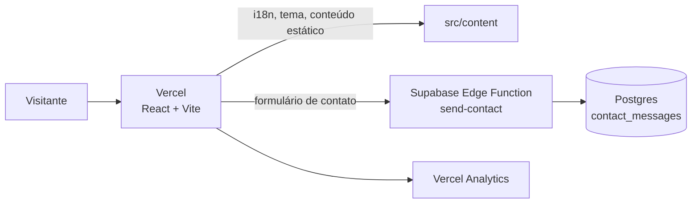

<p align="center">
  
</p>

<p align="center">
  
  
  
  
  
  
  
</p>

<p align="center">
  <b>Um portfólio one-page, bilíngue e acessível, com identidade editorial e easter eggs retrô (K7, VHS e vinil).</b><br/>
  Feito para recrutadores: currículo, LinkedIn e WhatsApp visíveis logo na primeira tela.
</p>

---

## ✨ Funcionalidades

|     | Funcionalidade                    | Detalhes                                                                                                             |
| --- | --------------------------------- | -------------------------------------------------------------------------------------------------------------------- |
| 🌎  | **Bilíngue**                      | Português (padrão) e inglês, com detecção automática do idioma do navegador (`react-i18next`)                        |
| 🌗  | **Tema claro e escuro**           | Toggle em pílula, preferência salva e aplicada antes da primeira pintura (sem "flash")                               |
| 🧭  | **One-page com âncoras**          | Início, Sobre, Projetos, Habilidades e Fale comigo, com destaque da seção ativa                                      |
| 🗂️  | **Projetos como estudos de caso** | Cards com recorte e efeito 3D; cada projeto abre em modal com deep link `#projeto-<slug>`                            |
| 📅  | **Linha do tempo**                | Carreira, formação e certificações, navegável por teclado                                                            |
| 📬  | **Contato de verdade**            | Formulário com `react-hook-form` + `zod`, salvo no Postgres e enviado por uma Edge Function do Supabase              |
| 📼  | **Easter eggs retrô**             | Código Konami, sons opcionais (desligados por padrão), efeito VHS sob demanda e página 404 temática                  |
| ♿  | **Acessível**                     | HTML semântico, foco visível, contraste AA e respeito a `prefers-reduced-motion` (com botão para desligar animações) |
| 🔎  | **SEO e analytics**               | Open Graph, `canonical`, `sitemap.xml`, `robots.txt` e Vercel Analytics                                              |

## 🏗️ Arquitetura



## 🧰 Stack

| Camada              | Tecnologia                                 |
| ------------------- | ------------------------------------------ |
| Front-end           | React 19, Vite 6, TypeScript (strict)      |
| Estilo              | Tailwind CSS 4, shadcn/ui, Radix UI        |
| Formulários         | react-hook-form, zod                       |
| Internacionalização | i18next, react-i18next, detector de idioma |
| Back-end            | Supabase: Postgres, Edge Functions         |
| Deploy e métricas   | Vercel, Vercel Analytics                   |
| Qualidade           | ESLint, Prettier, Conventional Commits     |

## 🚀 Como rodar

Pré-requisitos: Node.js 20+ e [pnpm](https://pnpm.io).

```bash
git clone https://github.com/jeffersonme84-oss/portfolio-2027.git
cd portfolio-2027
pnpm install
cp .env.example .env.local   # preencha VITE_SUPABASE_URL, VITE_SUPABASE_ANON_KEY e VITE_SITE_URL
pnpm dev
```

| Comando          | O que faz                             |
| ---------------- | ------------------------------------- |
| `pnpm dev`       | Servidor de desenvolvimento           |
| `pnpm build`     | Checagem de tipos + build de produção |
| `pnpm preview`   | Pré-visualiza o build                 |
| `pnpm lint`      | ESLint                                |
| `pnpm typecheck` | TypeScript sem emitir arquivos        |
| `pnpm format`    | Prettier                              |

> Sem as variáveis do Supabase, o site funciona normalmente e o formulário mostra uma mensagem amigável.

## 📁 Estrutura

```
src/
├── components/
│   ├── layout/     # Header, Footer, toggles de tema e idioma
│   ├── retro/      # K7, VHS e vinil (easter eggs)
│   ├── sections/   # Hero, Sobre, Projetos, Habilidades, Contato
│   └── ui/         # componentes shadcn/ui
├── content/        # textos, projetos, habilidades e linha do tempo (editáveis)
├── i18n/           # traduções pt-BR e en-US
├── hooks/          # useTheme, useTypewriter, useKonami...
└── lib/            # cliente Supabase, validações, utilidades
supabase/
├── functions/send-contact/   # Edge Function do formulário
└── migrations/               # tabela de mensagens
```

## 🎮 Easter eggs

Tem segredo escondido. Dica: experimente o código mais famoso dos videogames no teclado. ⬆️⬆️⬇️⬇️⬅️➡️⬅️➡️🅱️🅰️

---

<p align="center">
  Feito por <b>Jefferson Moreira Evangelista</b> ·
  <a href="https://www.linkedin.com/in/jeffersonmevangelista/">LinkedIn</a> ·
  <a href="https://github.com/JeffersonEvangelista">GitHub</a> ·
  <a href="mailto:jeff.evangelista2027@icloud.com">E-mail</a>
</p>
