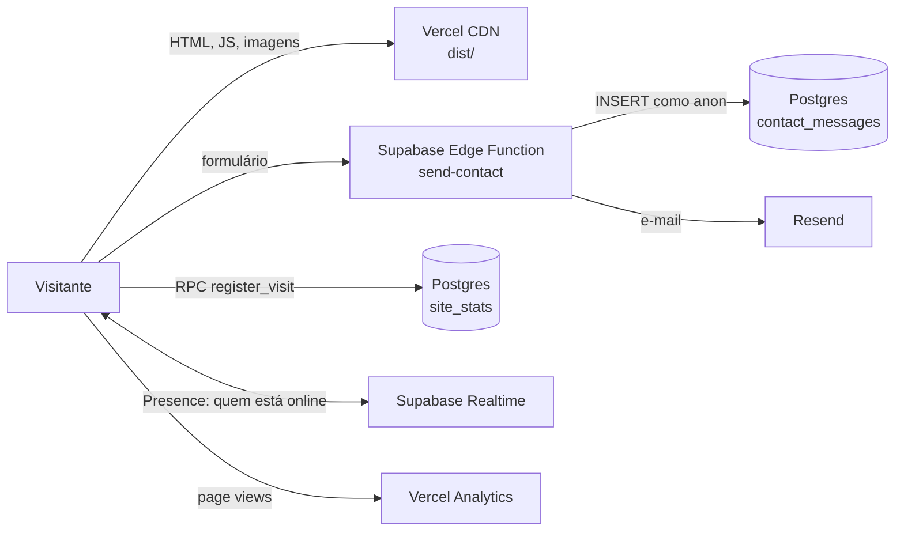

# Arquitetura

## Visão geral

O DEFT Portfolio é uma **SPA estática** (React + Vite) publicada na Vercel. Não existe servidor próprio: o HTML, o JS e as imagens saem da CDN da Vercel. As duas funções dinâmicas (formulário de contato e contador de visitas) usam o **Supabase** como back-end gerenciado.

## Camadas

| Camada                  | Onde                                   | Responsabilidade                                                                                                        |
| ----------------------- | -------------------------------------- | ----------------------------------------------------------------------------------------------------------------------- |
| **Conteúdo**            | `src/content/*.ts`                     | Dados tipados nos dois idiomas (`{ 'pt-BR', 'en-US' }`). Sem JSX nem lógica.                                            |
| **Textos da interface** | `src/i18n/locales/*.json`              | Rótulos, botões e títulos, via `t('chave')`.                                                                            |
| **Apresentação**        | `src/components/`                      | Componentes React. `sections/` = uma seção da página; `layout/` = moldura; `retro/` = efeitos; `ui/` = peças genéricas. |
| **Comportamento**       | `src/hooks/`                           | Estado e efeitos reutilizáveis (tema, idioma, digitação, rolagem).                                                      |
| **Serviços**            | `src/lib/`                             | Código sem tela: tema, animações, Supabase, contato, visitas, sons.                                                     |
| **Estilo**              | `src/styles/` + Tailwind               | Tokens de cor (`tokens.css`) e CSS dos efeitos que o Tailwind não cobre bem.                                            |
| **Build**               | `vite.config.ts`, `vite/seo-plugin.ts` | SEO, CSP com hash dos scripts, sitemap e robots.                                                                        |
| **Back-end**            | `supabase/`                            | Migrations (tabelas, RLS, função `register_visit`) e a Edge Function `send-contact`.                                    |

A regra que mantém o projeto simples: **o fluxo vai de cima para baixo**. Componentes leem `content/` e `i18n/`, usam `hooks/` e `lib/`, e nunca o contrário.

## Fluxo de carregamento

1. **`index.html`**: um script inline aplica tema, idioma e preferência de animação **antes da primeira pintura** (sem "flash"). Um segundo script, gerado pelo plugin, pré-carrega a arte da Home do tema certo.
2. **`main.tsx`**: inicia o i18n e renderiza o `App`.
3. **`App.tsx`**: monta Header, `Hero` (primeira dobra), Footer e os efeitos globais. O restante da página (`BelowFold`: Sobre, Projetos, Habilidades, Depoimentos, Contato) é carregado em um **chunk separado** (`React.lazy`), então a Home aparece sem esperar o JS das outras seções.
4. **`BootLoader`**: na primeira visita, toca a abertura em fita K7. As animações de entrada da Home esperam o fim dela (`src/lib/boot.ts`).
5. O formulário de contato e o `supabase-js` só carregam quando são necessários.

## Estado

Não há biblioteca de estado global: o site não precisa. O estado compartilhado vive em **módulos pequenos com assinantes** (padrão _external store_), lidos com `useSyncExternalStore`:

| Módulo          | Estado                                            |
| --------------- | ------------------------------------------------- |
| `lib/theme.ts`  | tema escolhido (claro / escuro / sistema)         |
| `lib/motion.ts` | animações ligadas ou reduzidas                    |
| `lib/boot.ts`   | se a tela de carregamento está ativa (e o replay) |
| `lib/visits.ts` | total de visitas e quem está online               |
| `i18n/index.ts` | idioma ativo                                      |

A preferência fica no `localStorage` com chaves fixas (`theme`, `motion`, `lang`, `boot-seen`, `visit-day`). As mesmas chaves são lidas pelo script inline do `index.html`.

## Navegação

One-page com âncoras (`#inicio`, `#sobre`, `#projetos`, `#habilidades`, `#contato`), sem roteador. A rolagem suave usa **Lenis** (`hooks/useSmoothScroll.ts`). O estudo de caso abre num modal (Radix Dialog) com link direto `#projeto-<slug>`. Qualquer outro caminho mostra a página 404 "SEM SINAL" (`vercel.json` reescreve tudo para o `index.html`).

## Home "DEFT."

A arte original (1376 × 768) entra **sem alterações**. No desktop ela vira uma "cena" escalada para caber na tela; textos e botões HTML ficam por cima, posicionados nas coordenadas da arte (`at(left, top)` em `Hero.tsx`). Onde a arte tinha um texto que mudou, uma "tampa" (`.deft-patch`) na cor do fundo cobre o original. No celular, a foto aparece recortada no topo e o conteúdo vem em HTML embaixo.

## Segurança

- **Sem segredos no front.** Só a URL e a chave _anon/publishable_ do Supabase, protegidas pela RLS. A chave do Resend fica nos _secrets_ do Supabase.
- **Banco**: RLS ligada em todas as tabelas. `contact_messages` só aceita `INSERT` (e só pela Edge Function); `site_stats` não tem acesso direto: tudo passa pela função `register_visit`.
- **Edge Function**: valida com zod, honeypot contra bots, limite de 5 mensagens / 10 min por IP, HTML do e-mail escapado.
- **Navegador**: CSP com hash de cada script inline, sem `eval` (gerada no build por `vite/seo-plugin.ts`), além de `X-Frame-Options`, `nosniff`, `Referrer-Policy`, `Permissions-Policy` e `COOP` (`vercel.json`).

## Acessibilidade e animações

Todo efeito respeita **animações reduzidas** (`prefers-reduced-motion` do sistema ou o botão do site): a classe `reduce-motion` no `<html>` alimenta as variantes `motion-safe:` e `motion-reduce:` do Tailwind e o CSS dos efeitos. HTML semântico, foco visível, link "pular para o conteúdo", navegação por teclado na trajetória e no modal.

## Decisões e o porquê

| Decisão                                      | Motivo                                                                       |
| -------------------------------------------- | ---------------------------------------------------------------------------- |
| SPA estática, sem SSR                        | Site de uma página; a Vercel serve da CDN, sem servidor para manter          |
| Conteúdo em arquivos `.ts`, sem painel admin | Mais simples, versionado no Git e tipado (o TypeScript pega erros de edição) |
| Supabase só para formulário e contador       | Back-end gerenciado, gratuito no volume do portfólio                         |
| CSS próprio para os efeitos retrô            | O Tailwind não cobre bem keyframes e máscaras complexas                      |
| Animações em CSS, sem framer-motion          | Menos JavaScript; tudo desliga com animações reduzidas                       |

O histórico completo de decisões de design está no [CLAUDE.md](../CLAUDE.md).
